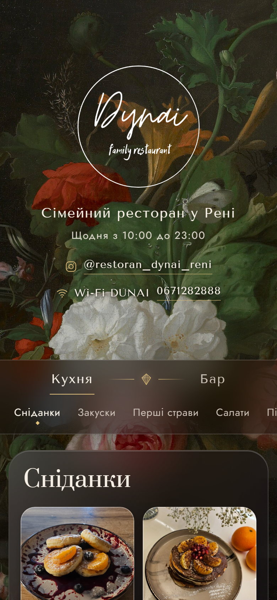

# Dunai — restaurant menu + Telegram admin bot

**Online menu for a real family restaurant in Reni, Ukraine**, with a Telegram bot that lets the owner
edit the menu from their phone. Replaced the restaurant's old Poster Shop page and runs on a free hosting plan.

**🔗 Live: [dunai-menu.dynai-reni.workers.dev](https://dunai-menu.dynai-reni.workers.dev)**

<p align="center">
  
</p>

## For guests

- **211 dishes and drinks** in two sections — Kitchen and Bar — with categories and photos
- Elegant design: classic still-life painting background, smoked-glass cards, gold accents
- Grid or compact list view, sticky category navigation
- Wi-Fi password in the header — tap to copy
- Opened from a **QR code** on the tables, built mobile-first

## For the owner — Telegram bot

- Password login with brute-force lockout, Ukrainian interface
- Add, edit and delete dishes and categories: name, price, weight, description
- **Stop-list** — temporarily hide a dish that ran out, in one tap
- Upload dish photos straight from the phone
- Search dishes by name — just type it in the chat
- Edit restaurant info (hours, Instagram, Wi-Fi) — the site updates instantly

## Architecture

One **Cloudflare Worker** serves both the menu page and the bot webhook.
Data and photos live in **Cloudflare D1** (SQLite). Hosting is free on the Cloudflare free plan.

```
Guest ──► Worker (menu page) ──► D1 (dishes, photos, settings)
Owner ──► Telegram ──► Worker (/webhook, bot) ──┘
```

## Tech stack

TypeScript · Cloudflare Workers · Cloudflare D1 (SQLite) · Telegram Bot API · Node.js scripts for data import

## Run locally

```bash
npm install
npm run dev       # wrangler dev
npm run deploy    # deploy to Cloudflare
```

Secrets (`BOT_TOKEN`, `ADMIN_PASSWORD`, `WEBHOOK_SECRET`) go into `.dev.vars` locally
and `wrangler secret put` in production — they are not stored in the repository.

---

Made by **[Kyryl](https://github.com/kyrylo157)** — available for freelance projects.
